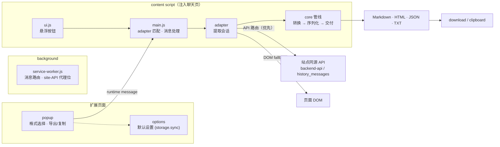

  <picture>
    <source media="(prefers-color-scheme: dark)" srcset="assets/logo-dark.png">
    
  </picture>

  <b>Export AI chat conversations to Markdown / HTML / JSON / TXT.</b> 
  A zero-build MV3 browser extension. Brand assets in <a href="assets/preview.html">assets/</a>.

## Supported sites

| 站点 | API 主路由 | DOM fallback | 状态 |
|---|---|---|---|
| ChatGPT | `/api/auth/session` → `backend-api/conversation/<id>` | `[data-message-author-role]`（覆盖临时对话 / 分享页） | ✅ |
| DeepSeek | `localStorage.userToken` → `/api/v0/chat/history_messages` | 虚拟列表项（长对话可能漏未渲染轮次，建议优先 API） | ✅ |
| Claude | — | — | 🚧 桩 |

## 安装（Load unpacked）

- `chrome://extensions` → 开发者模式 → 加载已解压的扩展程序 → 选择 `extension/` 子目录
  （不要加载仓库根目录：Chrome 会递归扫描加载目录，`.git`/tools 等不属于扩展）
- 迭代：改完代码 → 扩展卡片上点「重新加载」→ 刷新目标网页

## 架构

各模块职责：

- **适配器注册制**：每个站点一个 adapter（`content/adapters/*.js`），实现统一接口
  （`matches / conversationId / title / messageSelectors / containerSelector / extractConversation`），
  由 `content/main.js` 按 URL 选中并驱动统一的 提取 → 转换 → 导出 管线。
- **共享核心**（`content/core/`）：namespace/注册表、DOM 工具（含每站清理清单）、
  HTML→MD 转换（GFM 表格 / KaTeX 公式还原）、格式序列化（md/html/json/txt）、
  下载/剪贴板、悬浮按钮 UI。
- **background**：消息路由，留有 site-API 代理位（批量导出用）。
- **popup / options**：格式选择、导出触发、默认格式设置。
- **vendor/katex/**：KaTeX 0.16（katex.min.js 作为 content script 注入；
  `katex-inline.css` 由 `tools/gen-katex-inline.sh` 生成——woff2 字体全部内联为
  data URI，导出含公式的 HTML 时嵌入，保证导出文件离线自包含、零运行时 JS）。
- **tools/**：`gen-katex-inline.sh`（KaTeX 升级后重跑）、`smoke-export.test.js`
  （node 冒烟测试：LaTeX 风格转换 / 组件块处理 / 文件名）。

### 数据流

popup（或悬浮按钮）→ chrome.runtime message → content script
→ `adapter.extractConversation()` → `export.serialize(format)` → download / copy

## 导出设置

options 页（存 `chrome.storage.sync`）：

- 默认导出格式
- LaTeX 分隔符风格：obsidian `$`/`$$`（默认）/ plain `\(\)\[\]`（代码块免疫）
- GPT 内嵌组件块（`<box gap={2}>` 之类）：strip（默认）/ codeblock
- 文件名含模型名（API 路由取自 `default_model_slug`，DOM 路由暂无）

Markdown 导出格式：`[User]` / `[Assistant]` 轮次标记，无标题行。

## TODO 地图

- **chatgpt 引用脚注**：`metadata.search_result_groups` → `[^N]` + Sources，未实现
- **批量导出**（会话列表 + 逐个拉取）：`background/service-worker.js` 的 TODO 位
- **更多格式**：pdf / image / docx / notion（`content/core/export.js`）
- **Claude 适配器**：见上表

## 新增站点

复制任一 adapter 文件 → 改 `id` / `matches` / 选择器 → `manifest.json` 加对应
`content_scripts` 条目。注意 `js` 数组顺序：core 文件在前、`main.js` 在最后。
